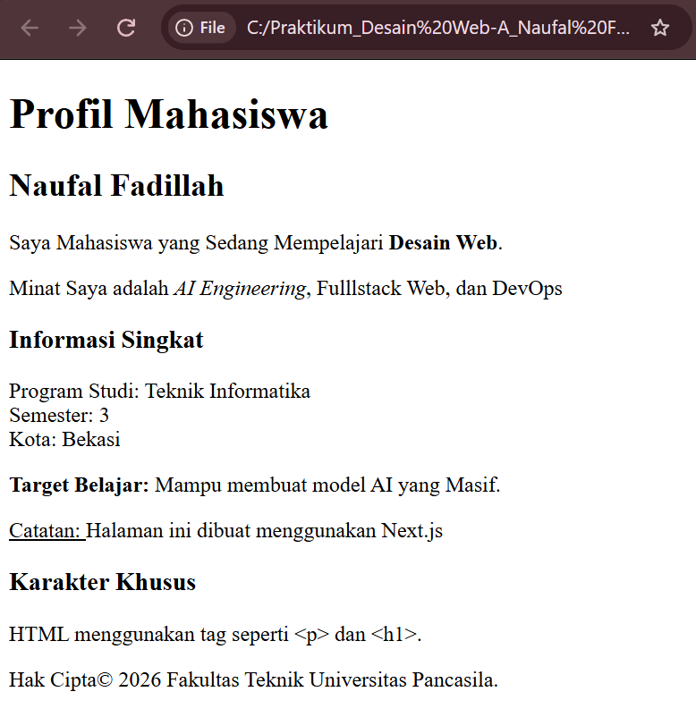

Profil Mahasiswa

## Deskripsi

Halaman ini merupakan profil mahasiswa sederhana yang dibuat untuk praktikum Desain Web pertemuan 1. Informasi yang ditampilkan meliputi nama, minat di bidang teknologi, informasi singkat tentang mahasiswa, target belajar, serta keterangan hak cipta. Tugas ini menggunakan struktur HTML dasar seperti heading, paragraf, penekanan teks, pindah baris, dan karakter khusus HTML.

## Struktur file

- [`Prak 1.html`](./Prak%201.html) — source code halaman profil mahasiswa.
- [`images/hasil.png`](./images/hasil.png) — bukti tampilan halaman di browser.
- `README.md` — dokumentasi dan ringkasan isi tugas.

## Pemeriksaan kebutuhan tugas

File HTML memuat judul halaman, satu `h1`, satu `h2`, dan dua `h3` untuk membagi informasi. Elemen paragraf (`p`) digunakan untuk menjelaskan profil, minat, informasi singkat, target belajar, dan hak cipta. Teks juga menggunakan `strong`, `em`, `b`, `u`, serta `br`. Karakter khusus ditampilkan menggunakan entity HTML seperti `&lt;`, `&gt;`, dan `&copy;`. Halaman menggunakan HTML dasar tanpa file CSS atau JavaScript terpisah.

## Ringkasan perubahan, masalah, dan solusi

Halaman disusun sebagai profil mahasiswa dengan informasi yang dibagi melalui heading agar lebih mudah dibaca. Bagian awal menampilkan nama dan minat, kemudian dilanjutkan dengan informasi singkat, target belajar, catatan teknologi, dan hak cipta. Elemen `strong`, `em`, `b`, dan `u` digunakan untuk memberi penekanan pada teks tertentu, sedangkan `br` memisahkan informasi program studi, semester, dan kota. Entity `&lt;` dan `&gt;` digunakan agar contoh tag HTML tampil sebagai teks, bukan dibaca sebagai elemen HTML oleh browser. Karena tugas ini masih menggunakan HTML dasar, tampilannya belum menggunakan styling CSS khusus atau pengaturan responsive melalui media query.

## Bukti tampilan

