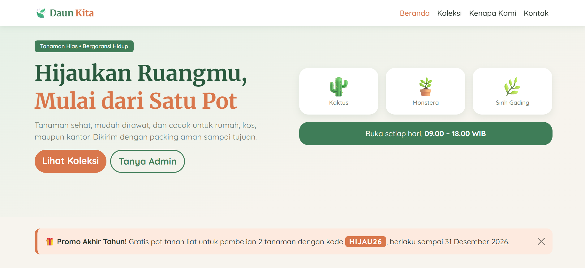
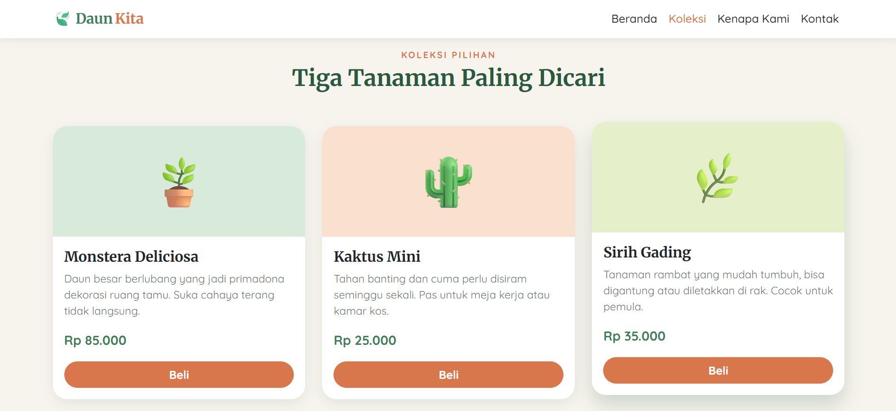
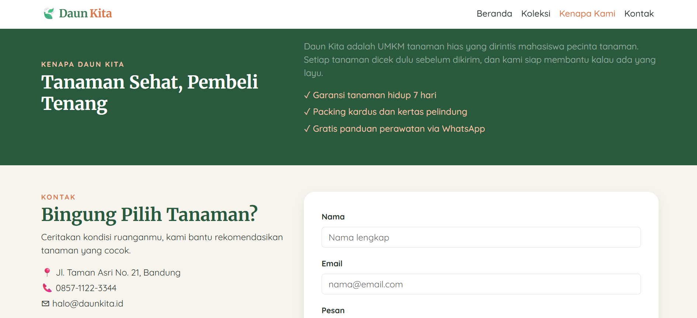
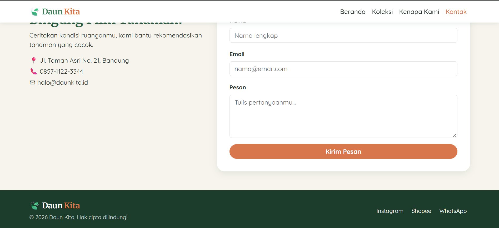
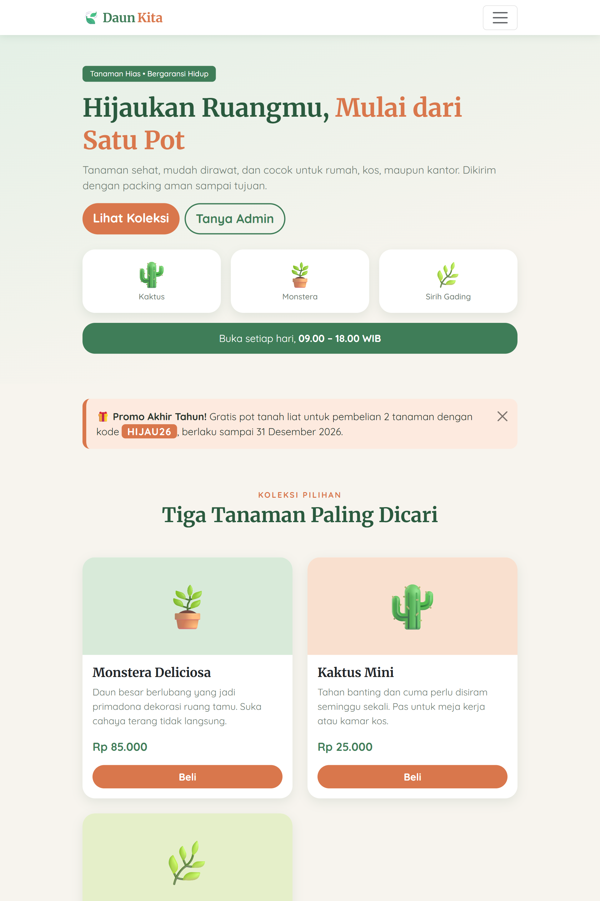
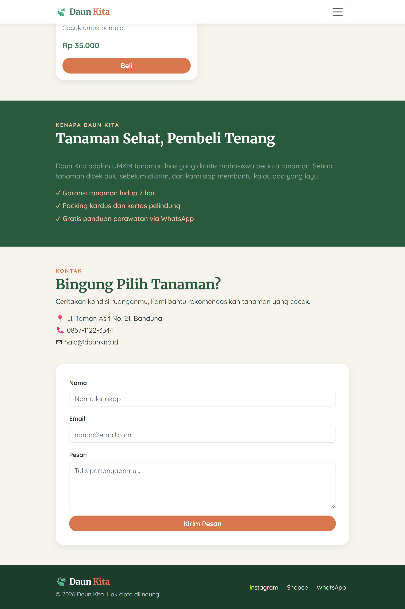
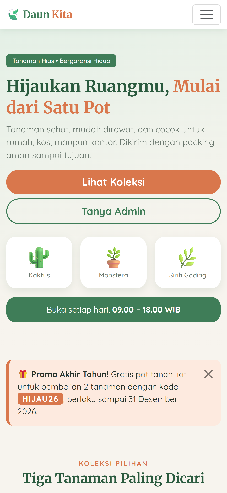
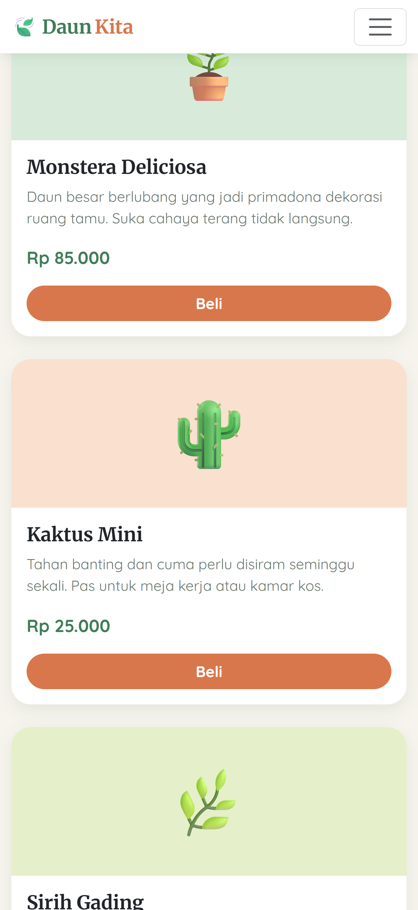
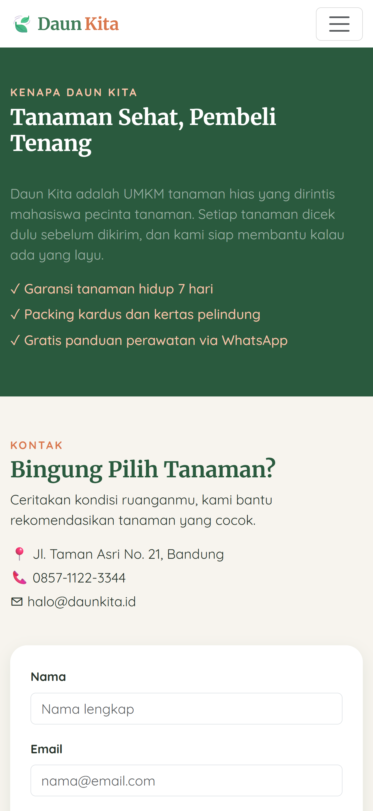

# Laporan Praktikum Pertemuan 10: Company Profile "Daun Kita"

**Nama:** (Naufal Fadillah)  
**NIM:** (4525210086)

## Deskripsi Tugas
Membuat website company profile satu halaman untuk UMKM toko tanaman hias **Daun Kita** menggunakan **Bootstrap 5.3.8 (CDN)** dan stylesheet custom (`css/style.css`) agar identitas brand tetap terasa.

## Struktur Folder
```
daun-kita/
├── index.html
├── css/
│   └── style.css
├── images/            (screenshot hasil)
└── README.md
```

## Komponen Bootstrap yang Digunakan
| Komponen | Class utama | Keterangan |
|---|---|---|
| Navbar | `navbar navbar-expand-lg sticky-top`, `navbar-toggler`, `navbar-collapse` | Menjadi hamburger di HP |
| Hero | `row align-items-center`, `col-12 col-lg-6`, `lead`, `badge`, `btn-lg` | Judul, deskripsi, 2 tombol aksi |
| Alert | `alert alert-dismissible fade show`, `btn-close` | Promo kode `HIJAU26`, bisa ditutup |
| Card (3 buah) | `card`, `card-body`, `card-title`, `card-text`, `h-100` | Koleksi tanaman |
| Grid | `col-12 col-md-6 col-lg-4`, `g-4` | 1 kolom HP, 2 tablet, 3 laptop |
| Modal | `modal fade`, `modal-dialog-centered`, `modal-header/body/footer` | Ketentuan pembelian |
| Form | `form-control`, `form-label`, atribut `required` | Nama, email, pesan |
| Utility | `py-5`, `mb-3`, `mt-auto`, `d-flex`, `gap-2`, `text-center`, `text-white`, `w-100` | Spasi dan tata letak |
| Scrollspy | `data-bs-spy="scroll"` | Menu navbar aktif saat di-scroll |

## Custom CSS (`css/style.css`)
- **Design tokens `:root`**: `--daun`, `--terakota`, `--putih-tulang`, `--teks`, `--radius`, serta variabel font.
- **Font**: Merriweather (judul) dan Quicksand (isi) dari Google Fonts.
- **Custom class**: `.nav-daun`, `.btn-daun`, `.btn-garis`, `.alert-promo`, `.kartu`, `.kotak-form`, `.modal-daun`, `.footer-daun`.
- `style.css` dipanggil **setelah** CSS Bootstrap sehingga bisa menimpa gaya bawaan tanpa `!important`.

## Screenshot Hasil
### Laptop (1280px) - 3 kolom





### Tablet (768px) - 2 kolom



### HP (375px) - 1 kolom




## Masalah dan Solusi
| Masalah | Solusi |
|---|---|
| Kartu 3 kolom terlalu sempit di HP | Memakai `col-12 col-md-6 col-lg-4` agar 1/2/3 kolom sesuai ukuran layar |
| Warna bawaan Bootstrap (biru) tidak sesuai brand | Membuat class custom (`.btn-daun`, `.nav-daun`) dengan variabel `:root` |
| Tinggi kartu tidak sama, tombol tidak sejajar | `h-100` pada card, `d-flex flex-column` pada `card-body`, `mt-auto` pada tombol |
| Tiga tombol beli membuka modal yang sama | Satu modal bersama dengan `data-bs-toggle="modal"` dan `data-bs-target="#modalBeli"` |
| Form bisa terkirim kosong | Atribut `required` pada semua input sehingga browser memvalidasi otomatis |
| Navbar sticky menutupi judul section | `scroll-padding-top: 70px` pada `html` |

## Cara Menjalankan
Buka `index.html` di browser (butuh internet untuk memuat Bootstrap dan Google Fonts dari CDN).
