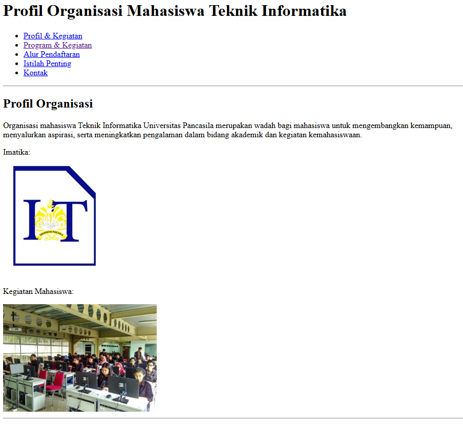
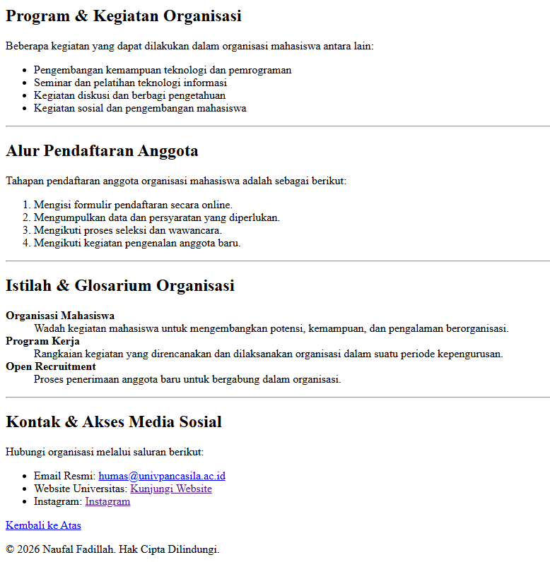

Profil Organisasi Mahasiswa Teknik Informatika

## Deskripsi

Halaman ini merupakan website sederhana yang memperkenalkan organisasi mahasiswa Teknik Informatika Universitas Pancasila, yaitu IMATIKA. Informasi disusun dalam beberapa bagian, mulai dari profil organisasi, program dan kegiatan, alur pendaftaran anggota, istilah penting, hingga kontak dan akses media sosial. Tugas ini berfokus pada penggunaan elemen HTML dasar, berbagai jenis list, gambar, serta tautan untuk membantu pengguna menjelajahi informasi.

## Struktur file

- [`index.html`](./index.html) — source code halaman profil organisasi.
- [`css/style.css`](./css/style.css) — file CSS untuk mengatur tampilan teks, gambar, dan tautan.
- [`images/imatika.jpg`](./images/imatika.jpg) — gambar IMATIKA yang ditampilkan pada halaman.
- [`images/kegiatan.jpg`](./images/kegiatan.jpg) — gambar kegiatan mahasiswa.
- [`dokumentasi/CODE1.png`](./dokumentasi/CODE1.png) — dokumentasi kode HTML.
- [`dokumentasi/CODE2.png`](./dokumentasi/CODE2.png) — dokumentasi kode HTML lanjutan.
- [`dokumentasi/HASIL1.png`](./dokumentasi/HASIL1.png) — dokumentasi hasil tampilan halaman.
- [`dokumentasi/HASIL2.png`](./dokumentasi/HASIL2.png) — dokumentasi hasil tampilan halaman.
- `README.md` — dokumentasi proyek.

## Pemeriksaan kebutuhan tugas

Halaman menggunakan heading utama `h1` dan beberapa heading `h2` untuk membagi informasi. Elemen `p` digunakan untuk paragraf, `ul` untuk daftar program dan tautan, `ol` untuk urutan pendaftaran, serta `dl`, `dt`, dan `dd` untuk glosarium. Gambar dilengkapi atribut `alt`, sedangkan navigasi internal menggunakan tautan menuju bagian dengan `id` tertentu. Halaman juga menyediakan tautan email dengan `mailto`, tautan eksternal ke situs Universitas Pancasila dan Instagram, serta tautan untuk kembali ke bagian atas halaman.

## Ringkasan perubahan, masalah, dan solusi

Halaman dibuat untuk menyajikan informasi organisasi secara terstruktur agar pengunjung dapat menemukan informasi yang dibutuhkan dengan lebih mudah. Konten dibagi menjadi profil organisasi, program dan kegiatan, alur pendaftaran anggota, glosarium, serta kontak. Navigasi internal ditambahkan menggunakan atribut `id` pada setiap bagian dan tautan anchor pada menu. Penggunaan `ul`, `ol`, dan `dl` disesuaikan dengan jenis informasi yang ditampilkan, sehingga daftar kegiatan, tahapan pendaftaran, dan istilah organisasi memiliki struktur yang berbeda sesuai fungsinya.

Dua gambar ditambahkan untuk mendukung informasi tentang IMATIKA dan kegiatan mahasiswa, masing-masing dengan teks alternatif melalui atribut `alt`. Tautan email dan tautan ke situs eksternal juga disediakan agar pengguna dapat mengakses informasi lanjutan. File `css/style.css` berisi aturan tampilan untuk jenis huruf, jarak halaman, warna heading, sudut gambar, dan efek hover pada tautan. Namun, pada `index.html` yang tersedia, file CSS tersebut belum dihubungkan melalui elemen `<link>` di bagian `<head>`, sehingga aturan CSS belum diterapkan ketika halaman dibuka. Agar styling aktif, tambahkan `<link rel="stylesheet" href="css/style.css">` di dalam bagian `<head>`. Nama dan lokasi file gambar juga perlu dipastikan sama persis dengan yang digunakan pada atribut `src`, karena nama file di sistem tertentu membedakan huruf besar dan kecil.

## Bukti tampilan

### Hasil tampilan 1

### Hasil tampilan 2

## Pengerjaan Tugas

Tugas ini dikerjakan secara mandiri, mulai dari menyusun struktur HTML,
menambahkan konten profil, mengatur tampilan menggunakan CSS, hingga
melakukan pengujian dan dokumentasi hasil halaman web.