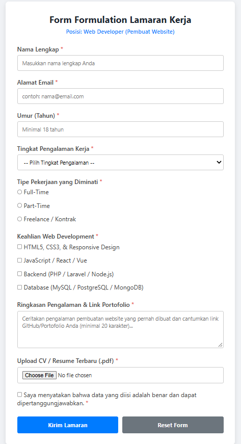

# Pertemuan 7 — Formulir Lamaran Kerja

## Deskripsi

Pada pertemuan 7, saya mempelajari cara membuat formulir menggunakan HTML dan CSS. Studi kasus yang dikerjakan adalah membuat form lamaran kerja untuk posisi Web Developer.

Formulir ini digunakan untuk mengumpulkan data pelamar, seperti identitas, pengalaman kerja, keanggotaan, dan CV.

## Materi yang Dipelajari

- Membuat formulir menggunakan tag `<form>`.
- Menggunakan input teks, email, nomor, dan file.
- Menggunakan select, radio button, dan checkbox.
- Menggunakan textarea untuk memasukkan deskripsi pengalaman.
- Menggunakan atribut `required`, `minlength`, `min`, dan `max` untuk validasi input.
- Mengatur tampilan berbentuk menggunakan CSS.
- Membuat tampilan responsif menggunakan media query.

## Studi Kasus — Form Lamaran Kerja

Formulir lamaran kerja dibuat menggunakan HTML dan CSS dengan beberapa bagian, yaitu:

1. Nama lengkap dan alamat email.
2. Umur dan tingkat pengalaman kerja.
3. Tipe pekerjaan yang diminati.
4. Keahlian dalam bidang Pengembangan Web.
5. Ringkasan pengalaman dan link portofolio.
6. Unggah CV atau resume dalam format PDF.
7. Konfirmasi kebenaran data pelamar.

## Struktur Folder

```
Pertemuan 7/
├── Contoh/
│   ├── Contoh 1/
│   │   ├── CSS/
│   │   │   └── style.css
│   │   └── index.html
│   └── Contoh 2/
│       ├── CSS/
│       │   └── style.css
│       └── index.html
├── Images/
│   └── hasil.png
└── Tugas/
    ├── CSS/
    │   └── style.css
    ├── Lamaran.html
    └── Readme.md
```

## Teknologi yang Digunakan

- HTML5
- CSS3

## Dokumentasi Hasil

Berikut merupakan tampilan hasil pengerjaan form lamaran kerja pada pertemuan 7.



## Kesimpulan

Melalui pertemuan 7, saya memahami cara membuat bentuk HTML dengan berbagai jenis input serta mengatur tampilannya menggunakan CSS. Saya juga mempelajari penggunaan validasi dasar dan media query untuk membuat formulir lebih mudah digunakan pada berbagai ukuran layar.
